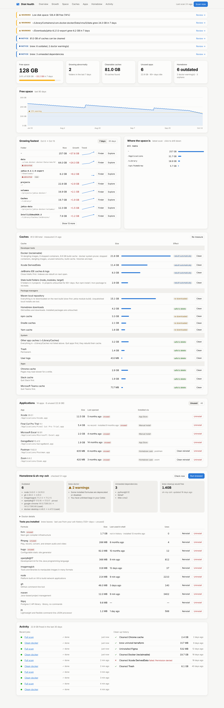

# Disk Health

A small local service for macOS that keeps an eye on your disk and helps you reclaim space safely.

- **Growth tracking**: hourly free-space samples plus a daily `du` snapshot, so you can see *which folder* grew and when.
- **Caches**: measures known caches (Homebrew, npm, Maven, Gradle, Docker, Xcode, JetBrains, browsers, Slack, …) and cleans them on request.
- **Unused apps & brew tools**: lists apps and Homebrew leaf formulae you haven't used in a while, with size and one-click removal.
- **brewed**: runs your `brewed` routine (update, upgrade, doctor, autoremove, cleanup, oh-my-zsh update) from the dashboard and shows the log live.
- **Chrome extension**: a toolbar badge with free space and notifications when something needs attention.

Python 3.9+ standard library only. No dependencies, no cloud, nothing leaves your Mac.



## Install

**Requirements**: macOS 11+, Python 3.9+ (Homebrew's `python3`, or Apple's once the Command Line Tools are
installed), Chrome for the extension. Homebrew, Docker and oh-my-zsh are optional: their panels just stay empty.

### With Homebrew (recommended)

The repository is its own Homebrew tap. You need read access to it (SSH key, or `gh auth setup-git` for
an https URL):

```bash
brew tap <owner>/disk-health <repo git URL>      # once
brew install disk-health
disk-health setup --open                         # starts the service, opens the dashboard
```

Then, once: grant Full Disk Access to `~/Applications/DiskHealth.app` (below) and run
`disk-health extension` for the Chrome extension folder. **Update**: `brew upgrade disk-health`; the
service notices the new version within a minute and restarts on it (the dashboard also shows an
"update available" alert with that command). Day to day:

```
disk-health status | open | restart [--logs] | stop | logs | extension | uninstall | version
```

`disk-health uninstall` removes the service; `brew uninstall disk-health` then removes the package.

### From a release zip (no Homebrew access to the repo)

```bash
cd ~/Downloads
unzip disk-health-1.0.0.zip
cd disk-health-1.0.0 && ./install.sh --open
```

The installer copies the code to `~/Library/Application Support/disk-health/app` and runs it from there, so
you can delete the zip and its folder afterwards. The zip contains a prebuilt launcher (Apple silicon +
Intel), so no compiler is needed. Then do the two manual steps the installer prints:
grant Full Disk Access to `~/Applications/DiskHealth.app` and load the Chrome extension (both below).

**Update**: unzip the new release and run its `./install.sh`. History, settings and the Full Disk Access
grant are kept (the grant is only lost when `launcher/launcher.c` changes, which the release notes say).

### From a git checkout (development)

```bash
git clone <repo-url> ~/projects/disk-health
cd ~/projects/disk-health && ./install.sh --open
```

Here the service runs from the checkout, so keep it where it is (not in Downloads, Desktop or Documents:
macOS protects those). **Update**: `git pull && ./install.sh`.

### What the installer does

It picks Homebrew's `python3` (or `/usr/bin/python3`), creates
`~/Library/Application Support/disk-health/` (database, `config.json`, token, logs) and installs a
LaunchAgent (`com.diskhealth.agent`) that starts at login, restarts if it stops, and runs at low
CPU/IO priority. Re-running it is safe. `./install.sh --dry-run` prints the LaunchAgent plist without
changing anything.

### Update notifications

Once a day the service checks for a newer version and shows an alert (and a Chrome notification) with
the update command or a download link. Click the version next to the title to check now.

- Git checkout: `git fetch` (non-interactive; it needs a remote that fetches without a password prompt,
  e.g. SSH keys or a credential helper).
- Release zip: set `"update_url"` in `config.json` to a URL that returns the latest version, either plain
  text (e.g. the raw `VERSION` file of a public repo) or GitHub's
  `https://api.github.com/repos/<owner>/<repo>/releases/latest`. `"update_page"` is the download link
  shown in the alert. Set `"update_check": false` to turn it off. Nothing is ever installed automatically.

### Full Disk Access (recommended)

Without it, `du` can't read `~/Library/Containers`, Mail, Safari, Messages, the Trash, etc., and
sizes are under-reported. The installer builds a tiny launcher, `~/Applications/DiskHealth.app`
(source in `launcher/launcher.c`), that the LaunchAgent starts; Python runs as its child and inherits
its permissions. Grant access to that app, not to Python: System Settings → Privacy & Security →
Full Disk Access → **+** → press **Cmd+Shift+G** → paste `~/Applications/DiskHealth.app` → Open.
(Homebrew's Python can't be added there: the picker treats it as a document, and its path changes on
every Python upgrade. The launcher's grant survives upgrades.) Then:

```bash
launchctl kickstart -k gui/$(id -u)/com.diskhealth.agent
```


### Chrome extension

`chrome://extensions` → enable **Developer mode** → **Load unpacked** → select the `extension/` folder.

### Open the dashboard

<http://127.0.0.1:7777>. The first scan starts automatically within a minute and may take several minutes.

## Using it

| Section | What you get | Actions |
|---|---|---|
| Overview | Free space, free-space history, alerts, space freed in the last 30 days | Scan now |
| Growth | Folders that grew over 7 / 30 days; drill down the tree | Reveal in Finder |
| Caches | Size and risk of each cache (`safe`, `rebuild`, `redownload`) | Clean (with confirmation) |
| Apps | Apps by last use and size, source (manual, App Store, brew cask), leftovers in `~/Library` | Uninstall, clean reinstall |
| Homebrew | Outdated packages, `brew doctor` warnings, orphaned deps, cleanup estimate, leaf tools by last use | Run brewed, uninstall / reinstall a leaf |
| Trash | Items in `~/.Trash` by size and age | Empty Trash, delete one item, put back items Disk Health trashed |
| Git | Local clones (GitHub first): size, `.git` size, last sync (last fetch/pull/push, read from files, no network), last commit, uncommitted / unpushed / stashed work | Fetch, `git gc`, remove a clone (to the Trash, refused if it has local work) |
| Map | Treemap of the latest scan, colored by size or by 7/30-day growth; click to zoom | Reveal in Finder |
| Storage | APFS container, Time Machine local snapshots ("purgeable"), iPhone backups, simulators, Xcode archives, Mail / Messages attachments, Photos, iCloud Drive | Thin / delete snapshots, trash old backups, archives, simulator runtimes |
| Docker | Engine & VM disk (allocated vs used), images (in use, dangling, old tags), containers, volumes (unused), build cache | Remove one item, targeted prunes |
| Toolchains | JDKs, SDKMAN, jenv, nvm/fnm/Volta, pyenv/uv, rbenv/RVM, Go, rustup: size, default, pinned by projects, last use | Remove an unused version |
| Duplicates | Identical files in Downloads, Documents, Desktop (by size + hash) | Move a copy to the Trash, keep newest |
| Logs | Full output of every job and the service log | Follow live, copy |

Scheduled jobs: free-space sample every hour; full scan (du snapshot, caches, apps, Git clones, Docker, storage, toolchains) daily; Homebrew
check daily. **Scheduled runs only check Homebrew**; nothing is upgraded until you click *Run brewed*.

### brewed

Your alias `brew update && brew upgrade -q; brew doctor && brew autoremove && omz update && omz reload`
runs as independent steps: a `brew doctor` warning no longer blocks `autoremove`/`omz update`,
`brew cleanup -s --prune=30` is added, and `omz reload` is skipped (it only makes sense in an
interactive shell: open a new tab instead).

### mise

If [mise](https://mise.jdx.dev) is installed, the Homebrew panel also shows what it holds
(`~/.local/share/mise/installs`, per tool), its cache, `mise doctor`, and two things to act on:

- **Outdated (within requested range)**: `mise outdated` run in your home folder and in every project mise
  has loaded (its tracked configs). **Upgrade tools** runs `mise upgrade` in those folders: each tool moves to
  the newest version its config allows (`node = "20"` → latest 20.x). No `--bump`, no config file changed.
  It is a separate button: “Run brewed” stays identical to your alias.
- **Not used by any project**: what `mise prune --tools` would delete (versions no tracked config asks
  for). **Prune unused** runs it after a confirmation. An alert fires above `mise_prune_alert_gb` (1 GB).

mise is called without shell activation, so `mise doctor`'s "not activated" warnings are ignored. In
project folders it never answers prompts for you: an untrusted `mise.toml` is skipped, not trusted.
The mise cache is also in the Caches panel, and the Toolchains panel lists mise's Java/Node/Python/Ruby/Go/
Rust versions next to nvm, SDKMAN & co., with `mise.toml` pins (including `.config/mise.toml`) protecting
the versions projects use. If mise was installed with Homebrew, `brew upgrade` updates it; otherwise a
**Self-update** button runs `mise self-update`.

## Safety model

- Nothing is deleted without an explicit confirmation in the dashboard.
- App uninstalls move the app and its leftovers **to the Trash** (falling back to Finder, which asks
  for your password when needed); nothing is gone until you empty the Trash.
  Apps installed with a cask are removed with `brew uninstall --cask --zap`.
- Only brew *leaf* formulae (nothing depends on them) can be removed.
- Docker cleanup uses `docker system prune` / `builder prune`; **volumes are never touched**.
- A folder is only emptied if it is inside your home folder and is not one of the protected
  folders (`~`, `~/Documents`, `~/Desktop`, `~/Downloads`, `~/Library`, …). Both checks compare
  **inodes, not path strings**: on a case-insensitive volume `~/documents` and `~/Documents` are
  the same folder, and a string comparison would not notice.

### The web server

- Listens on `127.0.0.1` only, and checks the `Host` header on every request (anti DNS-rebinding:
  a page on `evil.example` resolving to 127.0.0.1 still sends its own `Host`).
- State-changing POSTs require a random token (mode 600 in the data folder, compared in constant
  time). A web page cannot attach that header cross-origin — it forces a preflight that is never
  answered. The token is reissued if its file is ever readable by anyone but the owner.
- POSTs are also refused on a mismatched `Origin`, or a `Sec-Fetch-Site` other than `same-origin`.
  A client that sends neither (curl, a script) is allowed: the token is what protects it.
- The dashboard's inline script runs under a per-response CSP nonce, so `script-src` does not need
  `'unsafe-inline'`; `base-uri`, `form-action`, `object-src` and `frame-ancestors` are all closed.
  Every response also carries `nosniff`, `Referrer-Policy: no-referrer` and the cross-origin
  isolation headers.

### The launcher

`~/Applications/DiskHealth.app` is the process that holds Full Disk Access, so it keeps its job
narrow: it checks that the program it was told to run is an absolute path to an executable file,
removes `DYLD_*` and `LD_PRELOAD` from the environment it hands to Python, starts it with default
signal dispositions, and forwards SIGTERM/INT/HUP. It never reads or writes a file.

Scope worth stating: scrubbing `DYLD_*` protects Python and everything Python runs, not the
launcher's own process — dyld acts before `main()` and only ignores those variables for a
Developer ID signature, which an ad-hoc signature is not. Setting the agent's environment already
requires write access to the LaunchAgent plist in your home folder.

## How "unused" is determined

- **Apps**: Spotlight's `kMDItemLastUsedDate` (falls back to the install date). Unused after
  `unused_app_days` (90). Apple system apps are ignored. If Spotlight is disabled, everything looks old.
- **Brew tools**: the binaries each leaf formula installs are matched against `~/.zsh_history`
  (extended history timestamps). Unused after `unused_tool_days` (120).
  Limitation: tools invoked only by scripts, IDEs, Makefiles or other tools are never seen; check
  before removing. Libraries without binaries are never flagged.

## Configuration

Edit `~/Library/Application Support/disk-health/config.json` (see `config.example.json`), then restart
the agent. Keys starting with `_` are comments.

| Key | Default | Meaning |
|---|---|---|
| `port` | `7777` | Dashboard port (the extension expects 7777) |
| `scan_roots` | `~`, `/Applications`, `/Library`, `{brew_prefix}` | Folders measured with `du` |
| `scan_depth` / `scan_min_mb` | `5` / `50` | Depth and minimum size kept in history |
| `scan_exclude` | iCloud Drive, CloudStorage | Never scanned (avoids triggering downloads) |
| `scan_every_hours` | `24` | Full scan interval |
| `brew_check_every_hours` | `24` | Homebrew check interval |
| `free_sample_every_minutes` | `60` | Free-space sampling |
| `free_warn_percent` / `free_critical_percent` | `15` / `8` | Free-space alerts |
| `growth_alert_gb_7d` / `growth_alert_ratio_7d` | `2.0` / `0.25` | Folder growth alert (both must be exceeded) |
| `cache_alert_gb` | `20` | Alert when cleanable caches exceed this |
| `unused_app_days` / `unused_tool_days` | `90` / `120` | "Unused" thresholds |
| `brew_cleanup_prune_days` | `30` | `brew cleanup --prune` in brewed |
| `omz_dir` / `zsh_history` | `~/.oh-my-zsh` / `~/.zsh_history` | oh-my-zsh and history locations |
| `extra_caches` | `[]` | Your own cache folders (see the example entry) |
| `trash_alert_gb` | `2` | Alert when the Trash holds more than this |
| `git_roots` | `[]` (= `~/projects`, `~/dev`, `~/git`, `~/IdeaProjects`, `~/src`, ...) | Folders searched for Git clones (5 levels deep) |
| `git_stale_days` | `90` | A clone not synced for this long is flagged "stale" |
| `maven_unused_days` | `90` | Maven / Gradle versions not used for this long are offered for cleanup |
| `docker_alert_gb` | `10` | Alert when Docker could reclaim more than this |
| `toolchain_unused_days` | `120` | A toolchain version unused for this long is flagged |
| `storage_backup_alert_gb` / `storage_snapshot_alert_days` | `20` / `7` | iPhone backup size / local snapshot age alerts |
| `duplicate_roots` / `duplicate_min_mb` | Downloads, Documents, Desktop / `1` | Where and how big for the duplicate finder |

## Command line

Run from the project folder (the service doesn't need to be stopped):

```bash
python3 -m diskhealth scan         # full scan now
python3 -m diskhealth brew-check   # Homebrew check now
python3 -m diskhealth brewed       # run the brewed sequence in the terminal
python3 -m diskhealth status       # JSON status (same as /api/status)
python3 -m diskhealth serve        # run the server in the foreground (stop the agent first)
```

## Troubleshooting

- **Logs**: `~/Library/Application Support/disk-health/logs/agent.log`
- **Is it running?** `launchctl print gui/$(id -u)/com.diskhealth.agent | head -20`, or `curl -s http://127.0.0.1:7777/api/status`
- **Port in use**: `lsof -nP -iTCP:7777 -sTCP:LISTEN`; change `port` in config.json and re-run `./install.sh`.
- **Sizes look too small / Containers missing**: Full Disk Access isn't granted to
  `~/Applications/DiskHealth.app`, or the agent wasn't restarted afterwards (`launchctl kickstart -k …`).
  If `launcher/launcher.c` changed, `./install.sh` rebuilds the app: remove and re-add it in the list.
- **Extension badge empty / no notifications**: the service isn't running, or you changed the port.
- **Restart**: `./restart.sh` (or `./restart.sh --logs` to follow the log, `./restart.sh --stop` to stop it)

## Uninstall

```bash
./uninstall.sh      # zip install: "~/Library/Application Support/disk-health/app/uninstall.sh"
```

Stops the agent, removes the LaunchAgent, `~/Applications/DiskHealth.app` and (zip installs) the
installed code, then asks before deleting the data folder. Remove the Chrome extension and the Full
Disk Access entry yourself.

## Making a release

On a Mac with the Command Line Tools:

1. Bump `VERSION` and add an entry to `CHANGELOG.md`; commit.
2. `./make-release.sh --tag` builds `dist/disk-health-<version>.zip` (code + universal launcher +
   `RELEASE` marker), `dist/disk-health-extension-<version>.zip` and a `.sha256`, tags `v<version>`, then
   points `Formula/disk-health.rb` at that tag (URL from the `origin` remote) in a commit of its own.
3. `git push origin <branch> v<version>` (the script prints it). Colleagues get it with
   `brew upgrade disk-health` after their next `brew update` (Disk Health's daily Homebrew check runs it).
   Optionally attach the zip to the release:
   `gh release create v<version> dist/disk-health-<version>.zip --notes-file <notes>`.

The launcher is ad-hoc signed, not notarized. That is fine for a zip unpacked and installed from
Terminal (the installer removes the quarantine flag); a double-click installer for wider distribution
would need an Apple Developer ID.

## Related tools

For heavier lifting or a different angle:
[Mole](https://github.com/tw93/Mole) (CLI deep clean),
[Pearcleaner](https://github.com/alienator88/Pearcleaner) (app uninstaller with leftovers),
[GrandPerspective](https://grandperspectiv.sourceforge.net/) (treemap),
[gdu](https://github.com/dundee/gdu) / [ncdu](https://dev.yorhel.nl/ncdu) (fast terminal disk usage).

## Jobs and cancelling

Heavy jobs (scans, cleanups, brew, uninstalls) run one at a time; quick ones (panel refreshes, git fetch,
put back) run in parallel in their own lane. Every running or queued job can be cancelled from the progress
panel or the bar under the header; cancelling also stops the command it runs (du, brew, git, docker).

## Adding a panel

Feature modules live in `diskhealth/features/` (see the contract in its `__init__.py`) with their dashboard
side in `web/static/panel-<name>.js` (`DH.registerPanel`). They are discovered automatically.

## Tests

```bash
python3 -m unittest discover -s tests -t .        # the whole suite, one process
python3 -m unittest tests.test_engine -v          # one module
```

No dependencies and no network. The engine tests run on Linux too, against fake `brew`, `docker`
and `mdls` binaries on `PATH`; `tests/test_launcher.py` needs a C compiler and is skipped without
one. Each module gets its own `$HOME` and data folder from `tests/_env.py`, so the suite does not
depend on the order modules are imported in.

A note on one of them: `test_sigterm_in_the_spawn_window_does_not_orphan_the_child` compiles a
second, deliberately broken launcher and asserts that it *fails* the same check. A race test that
has never been watched to fail is not a regression test.

### Working on paths

Use `util.dedupe_dirs` / `util.scan_roots` for any list of folders to scan, and `util.is_under` /
`util.same_dir` to ask whether a path is inside or equal to another. Do not compare
`os.path.realpath()` strings: realpath resolves symlinks but **not letter case**, and macOS
volumes are case-insensitive by default, so `~/projects` and `~/Projects` compare unequal while
being the same directory. That mistake has cost this project a doubled Git scan and a
protected-folder check that silently failed open.

## License

[MIT](LICENSE) © 2026 Cedric Mailleux
